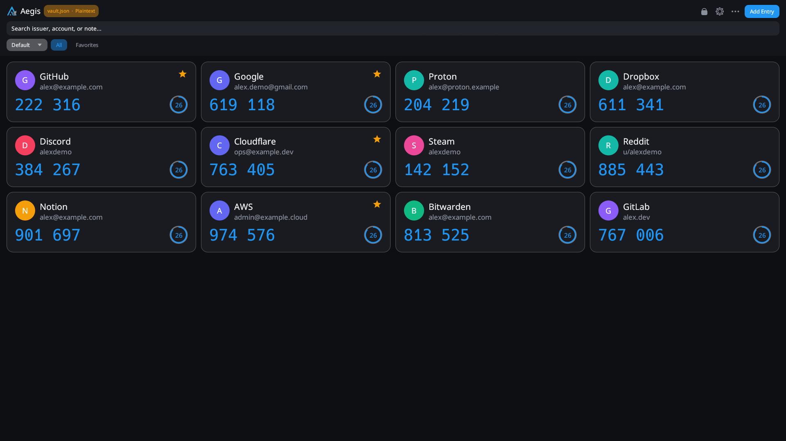
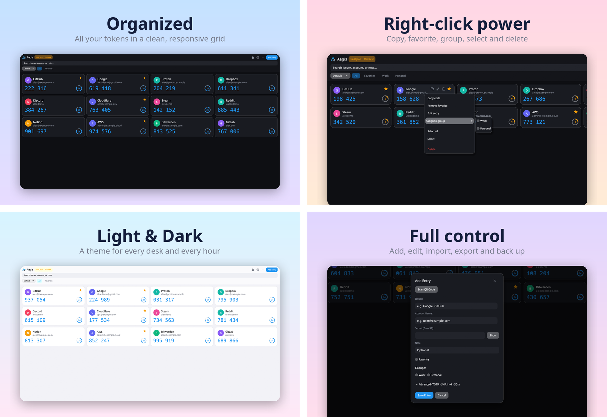

<p align="center">
  
</p>

<h1 align="center">Aegis Authenticator for Linux</h1>

<p align="center">
  <strong>Your Aegis 2FA vault, native on the Linux desktop.</strong><br/>
  Fast, private and beautiful — written in pure Rust. No Electron, no browser, no cloud.
</p>

<p align="center">
  <a href="https://github.com/KaanAlper/Aegis-Authleniticator-Linux/releases/latest"></a>
  
  
</p>

<p align="center">
  
</p>

---

## Why you'll like it

|  |  |
|---|---|
| **Opens your existing vault** | Reads and writes standard Aegis `.json` vaults (`AES-256-GCM` + `scrypt`). Bring your Android backup, keep using it. |
| **Truly native** | One small binary. Instant start, tiny memory footprint, Wayland and X11 out of the box. |
| **Clean, modern UI** | Soft cards, live countdown rings, dark and light themes, and a layout that adapts to any window size. |
| **Private by design** | Your vault stays on your machine. Imported vaults are copied into the app's own private storage (owner-only permissions). |
| **Every Aegis token type** | TOTP (SHA1/256/512), HOTP, Steam, MOTP and Yandex. |
| **Speaks your language** | English, Türkçe, Deutsch, Français, Español, Italiano, Português, Русский, Polski — or follow the system language. |

<p align="center">
  
</p>

## Made for daily use

- **One click to copy** a code, or hover a card for copy / edit / delete shortcuts.
- **Right-click any entry** — copy code, favorite, edit, assign to a group, select all, delete.
- **Multi-select** with `Ctrl`+click or `Ctrl`+`A`, then favorite, group or delete in bulk.
- **`Ctrl` + mouse wheel** scales the cards; the grid re-flows automatically. `Ctrl`+`0` resets.
- **Search, sort, favorites and groups** to keep large vaults tidy.
- **System tray** with a *Get Key* menu: pick an entry and its code is on your clipboard, with a desktop notification. Optional *keep running in tray* (works on Wayland too).
- **Safe by default** — auto-lock, password change asks for the current password, and every unencrypted export shows a clear warning.
- **Backups and exports** — scheduled backups, encrypted Aegis JSON export, plus HTML, plain-text and Google Authenticator migration formats.
- **Import** Aegis `.json`, `otpauth://` URIs (paste or `.txt`), or scan a QR code from an image or webcam.

## Install

### AppImage (any distro)

Download the latest `Aegis-Authenticator-*-x86_64.AppImage` from the
[Releases page](https://github.com/KaanAlper/Aegis-Authleniticator-Linux/releases/latest), then:

```bash
chmod +x Aegis-Authenticator-*-x86_64.AppImage
./Aegis-Authenticator-*-x86_64.AppImage
```

### One-line installer

Works on **Arch**, **Debian / Ubuntu**, **Fedora** and **openSUSE** — installs dependencies, builds in release mode and adds a launcher and icon:

```bash
curl -fsSL https://raw.githubusercontent.com/KaanAlper/Aegis-Authleniticator-Linux/main/install.sh | bash
```

### Arch Linux (PKGBUILD)

Ready-to-use `PKGBUILD`s live in [`packaging/aur`](packaging/aur) (`aegis-authenticator-linux` builds from source, `aegis-authenticator-linux-bin` installs the release AppImage):

```bash
git clone https://github.com/KaanAlper/Aegis-Authleniticator-Linux.git
cd Aegis-Authleniticator-Linux/packaging/aur/aegis-authenticator-linux
makepkg -si
```

### Build from source

```bash
# Arch
sudo pacman -S --needed base-devel pkgconf dbus libxkbcommon wayland mesa gtk3 libnotify wl-clipboard
# Debian / Ubuntu
sudo apt-get install -y build-essential pkg-config libdbus-1-dev libxkbcommon-dev libwayland-dev \
  libgl1-mesa-dev libegl1-mesa-dev libx11-dev libgtk-3-dev libnotify-bin wl-clipboard
# Fedora
sudo dnf install -y gcc pkgconf-pkg-config dbus-devel libxkbcommon-devel wayland-devel \
  mesa-libGL-devel mesa-libEGL-devel libX11-devel gtk3-devel libnotify wl-clipboard

cargo build --release
./target/release/aegis-linux
```

`wl-clipboard` is optional but recommended on Wayland for the most reliable copy-to-clipboard.

## Tests

```bash
cargo test
```

## License

Released under the [GNU GPL v3](LICENSE).

## Credits

[Aegis Authenticator](https://github.com/beemdevelopment/Aegis) is an Android app by Beem Development.
This is an independent, community-made Linux client that is compatible with its vault format and is not affiliated with the Aegis project.
